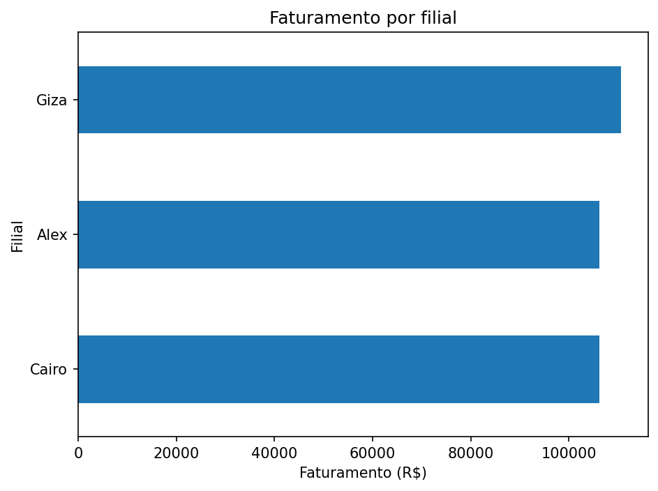
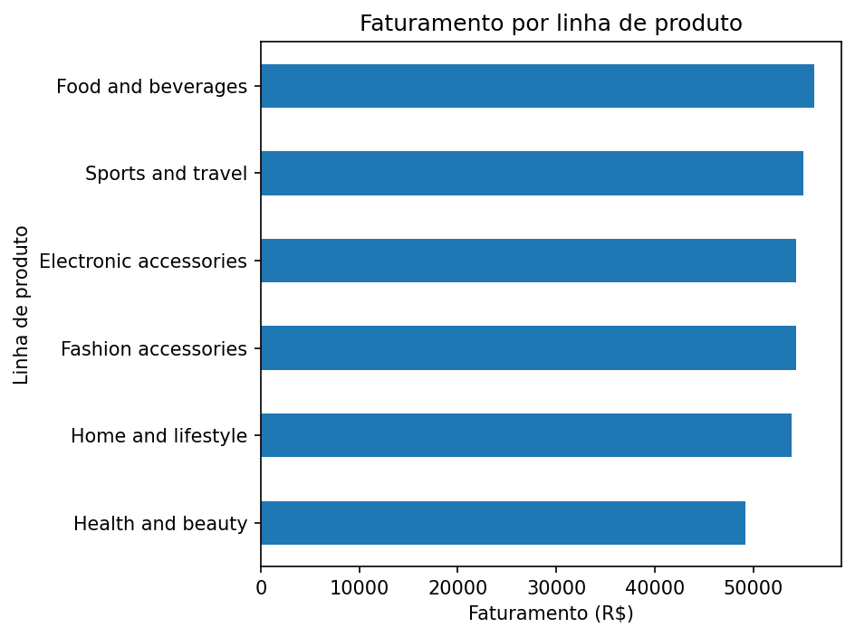
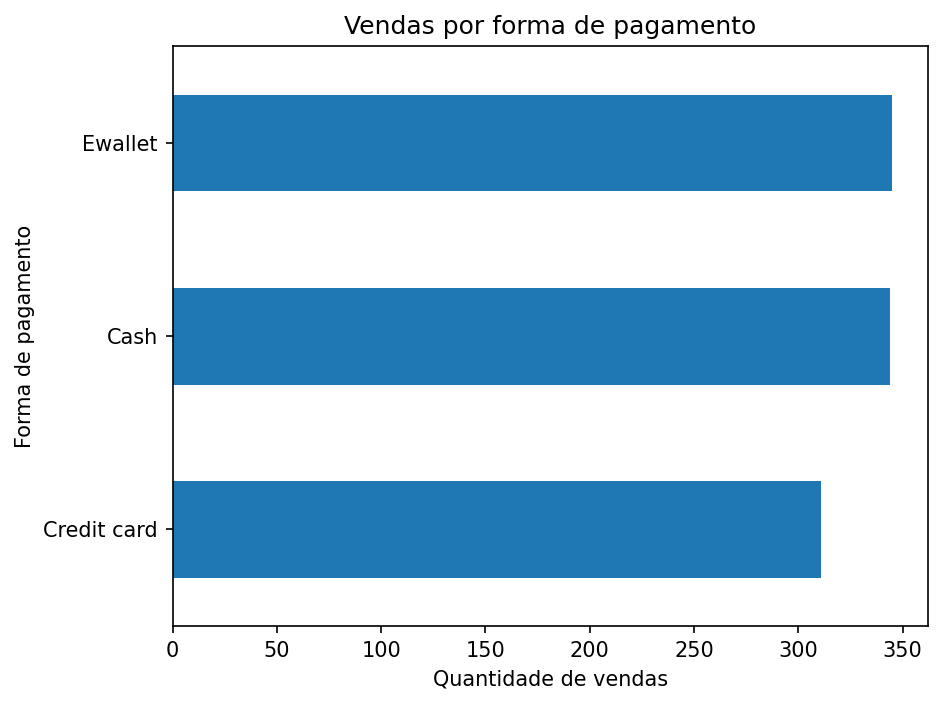
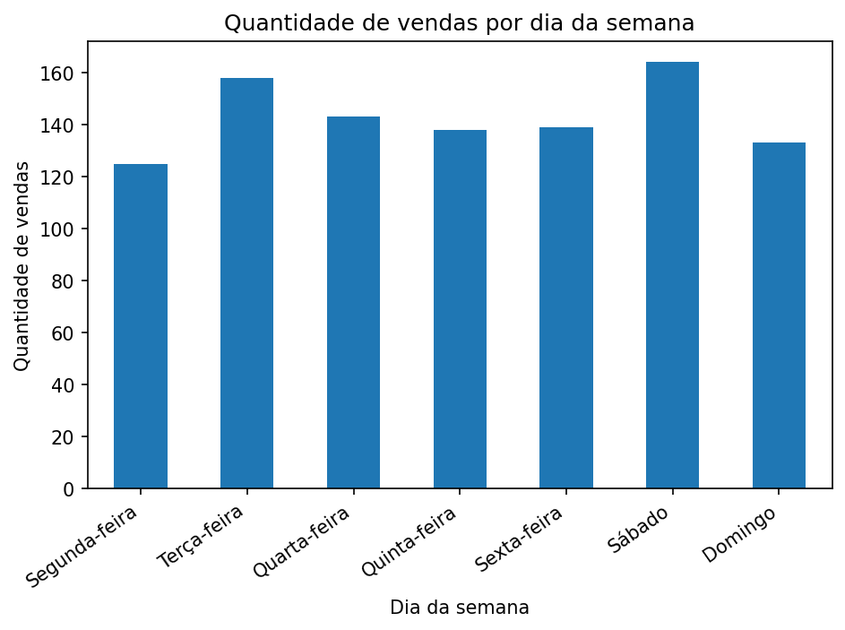
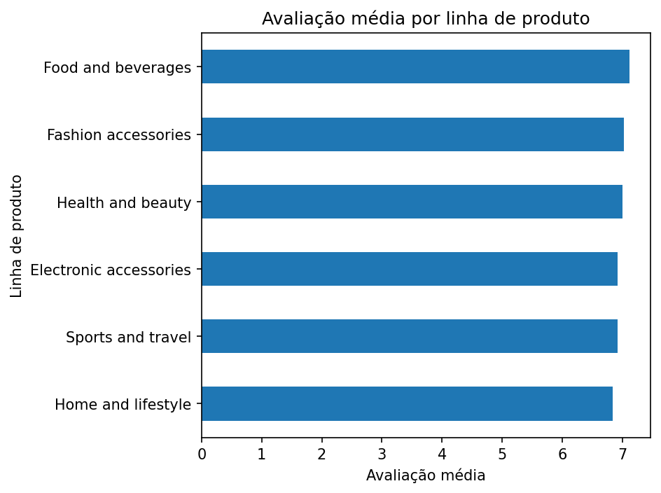

# Projeto Supermercado — Análise de Vendas

Projeto desenvolvido durante o curso de **Análise de Dados com Python do SENAI**. O objetivo é realizar a leitura, o tratamento e a análise de dados de vendas de um supermercado, armazenando os dados em PostgreSQL e respondendo a perguntas de negócio com Python, Pandas e SQL.

## Objetivos

- Preservar os dados originais em uma camada **Raw**.
- Tratar e padronizar os dados para análise.
- Armazenar os dados originais e tratados no PostgreSQL.
- Calcular indicadores estatísticos e responder a oito perguntas de negócio.
- Gerar gráficos para facilitar a interpretação dos resultados.

## Tecnologias utilizadas

- Python
- Pandas
- Matplotlib
- PostgreSQL
- pgAdmin 4
- Visual Studio Code
- Git e GitHub

## Estrutura do projeto

```text
Projeto_supermercado/
├── data/
│   ├── raw/                 # Arquivo CSV original
│   └── processed/           # Arquivo CSV tratado
├── resultados/              # Relatório e gráficos gerados
├── sql/
│   ├── 01_criar_banco.sql
│   ├── 02_criar_tabelas.sql
│   └── 03_consultas.sql
├── src/
│   ├── 01_leitura_dados.py
│   ├── 02_etl_vendas.py
│   ├── 03_estatistica.py
│   └── 04_importar_postgres.py
└── requirements.txt
```

## Dados e processo de tratamento

O conjunto de dados utilizado contém **1.000 registros de vendas**. O processo de ETL realiza a leitura do CSV original, padroniza os nomes das colunas, verifica duplicidades, converte os campos numéricos e de data/hora, trata registros inválidos e cria a coluna `dia_semana`.

O arquivo tratado é salvo em:

`data/processed/vendas_tratadas.csv`

O arquivo tratado contém 1.000 registros e inclui a coluna `dia_semana`.

## Banco de dados: camadas Raw e Tratada

O banco utilizado é `supermercado`, com duas tabelas:

- **`raw_vendas`**: armazena os dados de origem, preservando os campos originais como texto. O campo original `Sales` é mapeado para a coluna `Total` na tabela Raw.
- **`vendas_tratadas`**: armazena os dados após o tratamento, com campos tipados e a coluna adicional `dia_semana`.

O script `src/04_importar_postgres.py` carrega os dois arquivos CSV nas respectivas tabelas, dentro da mesma transação.

### Validação da importação

A importação foi executada e validada no PostgreSQL:

| Verificação | Resultado |
|---|---:|
| Registros em `raw_vendas` | 1.000 |
| Registros em `vendas_tratadas` | 1.000 |
| Registros com `dia_semana` preenchido | 1.000 |
| Diferença entre a soma de `valor_total` e a soma de `Total` da Raw | 0,0000 |

A coluna `valor_total` da tabela tratada utiliza precisão decimal de quatro casas (`NUMERIC(14,4)`) para preservar os valores importados do CSV.

> **Atenção:** a rotina de importação utiliza `TRUNCATE` antes de carregar os arquivos. Ao executá-la novamente, o conteúdo anterior das tabelas `raw_vendas` e `vendas_tratadas` será substituído pelos dados dos CSVs do projeto.

## Como executar

Execute os comandos a partir da pasta raiz do projeto.

### 1. Instalar as dependências

```bash
pip install -r requirements.txt
```

### 2. Ler e tratar os dados

```bash
python src/01_leitura_dados.py
python src/02_etl_vendas.py
```

### 3. Criar o banco e as tabelas

No pgAdmin 4:

1. Execute `sql/01_criar_banco.sql` para criar o banco `supermercado`.
2. Conecte-se ao banco `supermercado`.
3. Execute `sql/02_criar_tabelas.sql`.

### 4. Importar os dados para o PostgreSQL

Com o banco e as tabelas criados, execute:

```bash
python src/04_importar_postgres.py
```

O script solicitará a senha do usuário PostgreSQL configurado. A senha é digitada no terminal e não aparece na tela.

### 5. Gerar as estatísticas e os gráficos

```bash
python src/03_estatistica.py
```

O script gera o relatório `resultados/analise_completa.txt` e cinco gráficos PNG na pasta `resultados/`.

### 6. Executar as consultas SQL

No pgAdmin 4, conectado ao banco `supermercado`, execute:

`sql/03_consultas.sql`

O arquivo contém as consultas correspondentes às oito perguntas de negócio.

## Indicadores estatísticos gerais

| Indicador | Resultado |
|---|---:|
| Quantidade de vendas | 1.000 |
| Faturamento total | R$ 322.966,75 |
| Ticket médio | R$ 322,97 |
| Mediana das vendas | R$ 253,85 |
| Menor venda | R$ 10,68 |
| Maior venda | R$ 1.042,65 |
| Desvio padrão amostral | R$ 245,89 |
| Avaliação média dos clientes | 6,97 |

## Oito perguntas de negócio e respostas

| Nº | Pergunta | Resultado |
|---:|---|---|
| 1 | Qual filial apresentou o maior faturamento? | Giza — R$ 110.568,71 |
| 2 | Qual filial realizou a maior quantidade de vendas? | Alex — 340 vendas |
| 3 | Qual linha de produto apresentou o maior faturamento? | Food and beverages — R$ 56.144,84 |
| 4 | Qual linha de produto obteve a melhor avaliação média? | Food and beverages — 7,11 |
| 5 | Qual forma de pagamento foi mais utilizada? | Ewallet — 345 vendas |
| 6 | Qual foi o valor médio das vendas (ticket médio)? | R$ 322,97 |
| 7 | Qual foi a maior venda realizada? | ID 860-79-0874 — Giza — R$ 1.042,65 |
| 8 | Em qual dia da semana ocorreu a maior quantidade de vendas? | Sábado — 164 vendas |

## Gráficos da análise

### 1. Faturamento por filial



### 2. Faturamento por linha de produto



### 3. Vendas por forma de pagamento



### 4. Vendas por dia da semana



### 5. Avaliação média por linha de produto



O relatório completo, com os indicadores e detalhamentos por filial e linha de produto, está disponível em `resultados/analise_completa.txt`.

## Conclusão

O projeto reúne as etapas de leitura, tratamento, análise estatística e armazenamento em banco de dados. A separação entre as camadas Raw e Tratada permite preservar os dados de origem e utilizar dados padronizados nas consultas. As oito perguntas de negócio e os gráficos ajudam a transformar os registros de vendas em informações para apoiar a análise do desempenho do supermercado.
